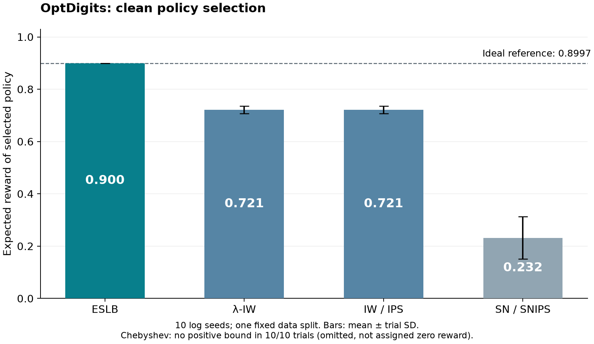

# OptDigits: off-policy selection and reward poisoning

This repository contains three empirical stages. **[E3: near-incumbent policies and the sibling-removal diagnostic](boundary/README.md)** is the latest follow-up: 327,600 audited decisions on 400 shared evaluation logs. It exposes harmful deployments once better sibling candidates are removed, but the confidence-based correction prevents those failures by always retaining the incumbent at the tested nonzero budgets. It does not yet demonstrate useful protected improvement under corruption.

**[E2: independently trained policies under reward poisoning](security/README.md)** evaluates the earlier, more widely separated library. That complete 400-log experiment found no harmful selections even without protection. Its source and results are preserved as a negative baseline.

**E0**, below, reproduces the authors' released clean OptDigits benchmark. The original code and result archive remain unchanged. The earlier [synthetic pilot](https://github.com/Jamil997/poisoned-logs-prior-pilot) is a separate snapshot.

---

## E0: a clean baseline for off-policy policy selection

This repository reproduces the OptDigits experiment available in the released code for **Kuzborskij et al. (AISTATS 2021), _Confident Off-Policy Evaluation and Selection through Self-Normalized Importance Weighting_**. It is the first empirical stage of a project on policy selection from potentially corrupted reward logs.

The purpose of this stage is to establish a traceable baseline before introducing an adversary. The experiment below contains stochastic reward noise, but no adversarial poisoning. The statistical estimators and policy-training algorithms are the authors' implementations. The additions here are an instrumented runner, saved trial-level outputs, exact finite-test-pool evaluation, and an independent numerical audit.

## Experimental setting

OptDigits is used as a contextual bandit task. The context is a 64-dimensional digit representation; the action is a prediction from ten digit classes. The dataset is OpenML **28**, with **5,620 examples**. The released implementation standardizes all feature rows and uses one fixed, shuffled 50:50 split: 2,810 rows for logged feedback and policy training, and 2,810 for testing. Trial seeds 0–9 change the sampled actions and rewards; they do **not** create ten different data splits.

The behavior policy is a label-based softmax rule with temperature 0.2. Its preferred prediction is shifted to an incorrect digit for classes 1 and 2. Each log row contains a context, the action taken, its reward, and its known logging probability. The reward is the indicator of a correct prediction, independently flipped with probability 0.1. Thus, “clean” here means free of an intentional attack, not free of random noise.

There are three candidate policies:

1. A linear softmax policy trained to maximize the importance-weighted objective.
2. A linear softmax policy trained to maximize the self-normalized objective.
3. An ideal softmax reference whose preferred action is the true digit label.

The learned policies have continuous parameters, with a 64 × 10 weight matrix. Only the list of candidates is finite. The ideal reference uses labels by construction and is not a deployable classifier. It makes the selection problem interpretable because the best candidate is known.

Training follows the released defaults: 10,000 gradient steps, step size 0.01, and target temperature 0.1. The two learned policies are trained on the same logged sample used for scoring. This feature is retained for reproduction; a later security experiment will separate training from evaluation.

## Estimation and evaluation

For a candidate policy $\pi$ and behavior policy $\mu$, the importance weight is

$$
w_i(\pi)=\frac{\pi(a_i\mid x_i)}{\mu(a_i\mid x_i)}.
$$

The two point estimators are

$$
\widehat V_{\mathrm{IW}}(\pi)=\frac{1}{n}\sum_i w_i(\pi)r_i,
\qquad
\widehat V_{\mathrm{SN}}(\pi)=\frac{\sum_i w_i(\pi)r_i}{\sum_i w_i(\pi)}.
$$

We also run the released Chebyshev bound for SN, the empirical Bernstein bound for λ-corrected IW, and the semi-empirical Efron–Stein lower bound (ESLB). Each method scores the same three candidates. The upstream evaluation records no selection when the largest score is non-positive. Such a case is reported as “no positive bound”; it is not assigned zero reward and does not implement a fallback policy.

The released configuration uses δ = 0.05 per candidate and, for ESLB, 10 Monte Carlo iterations of batch size 1,000 with `MultOneHot` bias control. These settings are reproduced as implemented; this experiment does not establish a simultaneous 95% guarantee for selected, data-trained policies.

Two evaluation quantities were specified before the run: selected-policy value and simple regret. We also recorded non-selection frequency and runtime. In addition to the authors' sampled test rewards, the known reward generator permits exact evaluation on the fixed test pool:

$$
V_T(\pi)=\frac{1}{|T|}\sum_{i\in T}\left[0.1+0.8\pi(y_i\mid x_i)\right],
\qquad
\mathrm{Regret}_T=\max_j V_T(\pi_j)-V_T(\widehat\pi).
$$

“Exact” integrates out action sampling and reward flips on these test examples. It does not mean that population performance is known. Test labels are used for this diagnostic and the original label-based reference, not to fit the two learned policies.

## Results

The ten-trial run completed on 15 October 2026. The table reports the mean and sample standard deviation across the ten trial-level expected values. Regret is measured relative to the best of the three candidates in each trial.

| Selection method | Expected test reward, mean ± SD | Mean simple regret | Selected candidate | No positive score |
|---|---:|---:|---|---:|
| ESLB | 0.8997 ± 0.0000 | 0.0000 | Ideal reference, 10/10 | 0/10 |
| λ-IW, empirical Bernstein | 0.7214 ± 0.0147 | 0.1782 | IW-trained, 10/10 | 0/10 |
| IW / IPS | 0.7214 ± 0.0147 | 0.1782 | IW-trained, 10/10 | 0/10 |
| SN / SNIPS | 0.2318 ± 0.0810 | 0.6679 | SN-trained, 10/10 | 0/10 |
| Chebyshev–SN | — | — | No positive bound | 10/10 |



ESLB selected the ideal reference in all ten trials. Its zero trial-level SD follows from repeatedly selecting a reference with fixed expected value; it is not evidence of zero statistical uncertainty. The other methods either selected weaker learned policies or returned a vacuous bound. These observations support using confidence-based selection as a baseline in this particular setup. They do not establish that SN estimation generally performs poorly: here, the SN objective is also used to train a candidate on the same sample that is subsequently used for selection.

The upstream sampled-reward calculation gave **0.8996** for ESLB and **0.7232** for λ-IW. Table 2 of the paper reports **0.91** and **0.72**, respectively, and a vacuous Chebyshev bound. The qualitative ordering agrees, but the numerical reproduction is incomplete. The appendix specifies 100,000 training steps, whereas the released demo defaults to 10,000. The available benchmark also omits the paper's DR, λ-DR, and empirical-likelihood comparisons. The remaining numerical differences have not been resolved, and no hyperparameters were adjusted to match the published table.

## Reproducibility and checks

The upstream source is pinned to commit [`3c867e75ca22fd6eb01ac21e41fdc77f47b06ca8`](https://github.com/google-deepmind/offpolicy_selection_eslb/tree/3c867e75ca22fd6eb01ac21e41fdc77f47b06ca8). `prepare_vendor.py` downloads that revision and verifies every file against `vendor_manifest.json`. The estimator, data-generation, and training files are unmodified.

The instrumented first trial was compared with a direct invocation of the upstream experiment. Both the sampled policy rewards and reference rewards were exactly equal. For all ten trials, deterministic diagnostics were checked not to advance NumPy's random state. A separate analysis script recomputes IW and SN scores, finite-pool values, selections, regret, and aggregate means from the saved arrays.

The measured ten-trial experiment took **88.9 seconds** on an Apple M5 Pro with 24 GiB RAM, using CPU-only JAX and its default 32-bit mode. This excludes package installation and initial imports. Average ESLB scoring time for all three candidates was **4.75 seconds per trial**. Timing and verification trials are not counted as additional independent observations.

The recorded environment uses Python 3.12.14, NumPy 2.5.4, SciPy 1.18.1, scikit-learn 1.9.1, and JAX/JAXlib 0.11.2. It is a current environment, not a reconstruction of the authors' 2021 dependencies. The runner's hardware metadata collection currently uses macOS `sysctl`.

```bash
python3 -m venv .venv
source .venv/bin/activate
python -m pip install -r requirements-lock.txt
python prepare_vendor.py
python run_clean.py --trials 10 --out results/new_run
python analyze_results.py --results results/new_run --figure new_run.png
```

For the one-trial comparison against the direct upstream entry point:

```bash
python run_clean.py --trials 1 --out results/new_check --verify
```

The repository includes a readable [summary](summary.json), the [trial-level table](trial_metrics.csv), the [protocol recorded before execution](protocol.json), and the [numerical audit](audit.json). [results.zip](results.zip) contains the complete ten-trial and timing outputs: logs, candidate probabilities, learned parameters, data-split hashes, score decompositions, environment records, and verification results. Extract it to inspect or reanalyse the saved run:

```bash
python -m zipfile -e results.zip .
python analyze_results.py --results results/clean_10 --figure checked_results.png
```

## Transition to the security experiment

The independent-policy security experiment planned after E0 is now complete. [E2](security/README.md) documents the changed data split, frozen learned policies, adaptive reward attacks, full grid, negative result, and remaining research limitations. Its results are separate from the clean reproduction above.

## Sources

- Kuzborskij, I., Vernade, C., György, A., and Szepesvári, C. (2021). [Confident Off-Policy Evaluation and Selection through Self-Normalized Importance Weighting](https://proceedings.mlr.press/v130/kuzborskij21a.html). AISTATS, PMLR 130:640–648. See Section 6.3, Table 2, and [Appendix C](https://proceedings.mlr.press/v130/kuzborskij21a/kuzborskij21a-supp.pdf).
- [Authors' released implementation](https://github.com/google-deepmind/offpolicy_selection_eslb). The executable protocol above follows `demo/benchmark.py`, `experiment.py`, `data.py`, and `policies.py` at the pinned commit. The upstream code is distributed under Apache 2.0; its license is retained when downloaded.
- [OpenML dataset 28: OptDigits](https://www.openml.org/d/28).
- [Earlier synthetic pilot](https://github.com/Jamil997/poisoned-logs-prior-pilot). Its results are separate from this reproduction.
