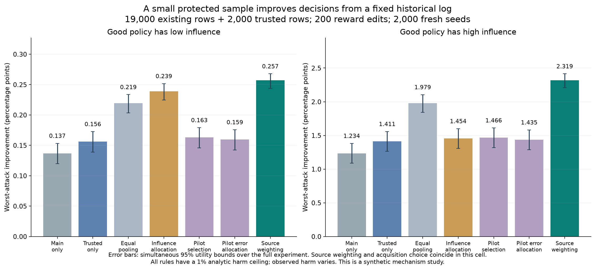
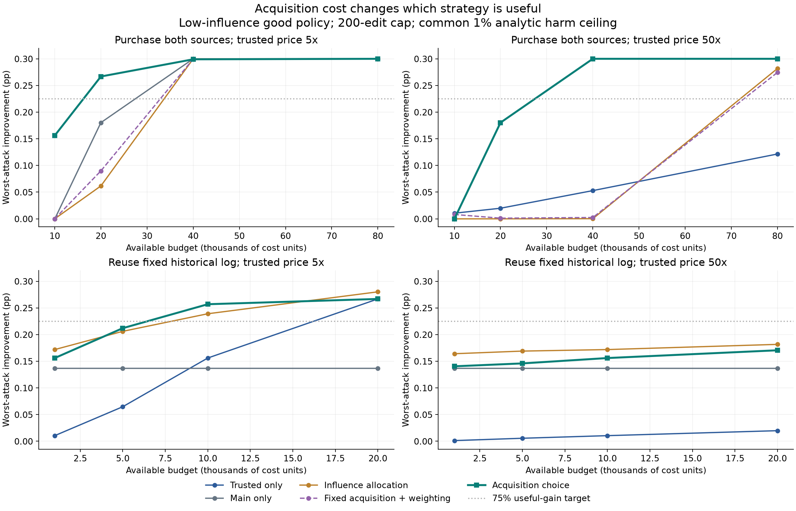
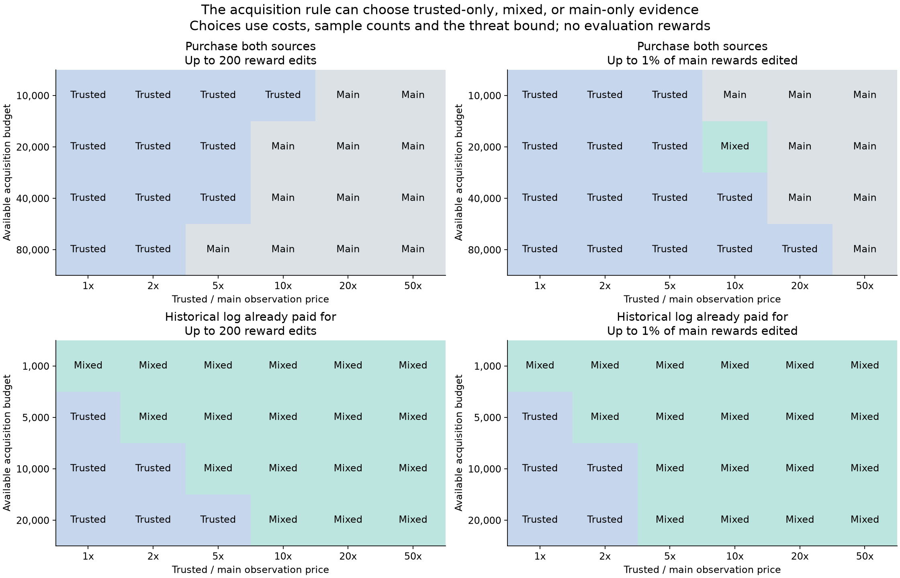

# E9: when should a policy evaluator buy trusted observations?

A trusted sample can reduce exposure to reward poisoning, but it also consumes resources that could be spent on a larger ordinary log. This experiment asks when combining the two sources is worthwhile. It tests three questions: how the answer changes with cost accounting, whether an acquisition rule can choose trusted-only evaluation, and how much additional evidence is needed to obtain a useful policy improvement.

The clearest result concerns a fixed historical log. With 19,000 historical observations and 2,000 new trusted observations, source weighting improves worst-attack utility over pooling and trusted-only evaluation in both tested policy geometries. When all observations can instead be purchased freely, the answer changes: acquiring more ordinary observations can outperform the mixture. An automatic acquisition rule also fails in several regimes. These failures identify the missing component of a stronger method: an objective that controls decision power or utility, rather than only the threshold for approval.

This is a controlled synthetic experiment, completed on 17 October 2026. It is separate from the repository's OptDigits experiments. [Research findings and the Pareto research plan](../RESEARCH_FINDINGS.md) place the result in the full experimental sequence.

## Population, policies, and attacker

The context is a pair of independent signs, $X=(\xi,\zeta)$, each uniformly distributed on $\{-1,+1\}$. The action $A$ is binary. Both the logger and the incumbent policy choose either action with probability $0.5$. The reward is

$$
R\mid X,A\sim\operatorname{Bernoulli}\left(0.5+(2A-1)(\beta\xi-\theta\zeta)\right).
$$

The fixed candidates satisfy $\pi_g(1\mid X)=0.5+g\xi$ and $\pi_b(1\mid X)=0.5+b\zeta$. Their population improvements over the incumbent are $\Delta_g=2g\beta$ and $\Delta_b=-2b\theta$. The paired importance-coefficient magnitudes are $B_g=2g$ and $B_b=2b$. These continuous policy probabilities are held fixed before evaluation; only the candidate list is finite. The labels “good” and “bad” are available to the evaluator and attacker, not to the acquisition rule.

The two geometries use $(g,b)=(0.05,0.45)$ and $(0.45,0.05)$. Reversing this relationship tests whether a rule succeeds merely because low sensitivity happens to identify the good policy. Signals are $\beta\in\{0.02,0.03,0.05\}$, with $\theta=0.001$.

Each ordinary log has $n$ observations. An independent trusted sample has $m$ observations from the same population and logger. A **white-box attacker** sees both samples, policies, thresholds, weights, and the complete decision rule. It can change ordinary-log rewards, but not contexts, actions, propensities, or trusted rewards. Separate experiments permit either at most $\min(n,200)$ edits or at most $\lceil n/100\rceil$ edits. The latter scales with the purchased sample size. A rule must either deploy a candidate or retain the incumbent, whose improvement is zero.

All attacks are performed on simulated data. No external system or private dataset is attacked. Reference integrity and a common source population are substantive assumptions; this experiment does not test their practical enforcement.

## Two resource models

In **total-purchase accounting**, an ordinary observation costs one unit and a trusted observation costs $\rho$ units. The cost is $C=n+\rho m$. Every method can spend the same budget on its own acquisition plan, including buying more ordinary observations. There is no artificial cap on that alternative.

In **historical-log accounting**, all methods have access to the same existing 19,000-row log. Its cost has already been paid; additional acquisition costs $C=\rho m$. Ordinary-log-only evaluation therefore has zero incremental cost. This model is appropriate only when the existing log is genuinely fixed and the new acquisition decision concerns trusted evidence.

The price ratios $\rho\in\{1,2,5,10,20,50\}$ are assumptions for sensitivity analysis, not measured prices. Conclusions from the two resource models are reported separately.

## The acquisition and deployment rule

Let $u_j$ and $v_j$ count positive signed centered-reward contributions for policy $j$ in the ordinary and trusted samples. Let $a$ and $c$ be nonnegative integer weights per observation in the two sources, and set $D=an+cm$. At the null boundary of zero improvement, the counts have independent binomial distributions with parameters $(n,0.5)$ and $(m,0.5)$. For a per-policy testing level $\alpha_j$, choose the integer threshold $h_j$ so that

$$
\Pr\{aZ_n+cZ_m\ge h_j\}\le\alpha_j,
\qquad Z_n\sim\operatorname{Binomial}(n,0.5),\quad Z_m\sim\operatorname{Binomial}(m,0.5).
$$

The corruption-adjusted score is

$$
S_j=B_j\frac{au_j+cv_j-h_j-ak+0.5}{D},
$$

where $k$ is the declared ordinary-log edit cap. The rule deploys the candidate with the largest positive score and otherwise retains the incumbent. The score is a calibrated decision statistic; it is not claimed to be a general confidence lower bound on the improvement magnitude. Allocating total testing error at most $\alpha$ controls harmful deployment under the stated model. The main comparisons use $\alpha=0.01$, with $\alpha=0.001$ as a second level.

For equal allocation, $\alpha_j=\alpha/2$. The joint acquisition rule searches the prespecified sample-size and weight grid, including true ordinary-only and trusted-only acquisition endpoints, and minimizes

$$
J(n,m,a,c)=\frac{h-0.5+2ak}{an+cm}-0.5.
$$

The term $2ak$ combines the worst downward change in the observed score with the correction retained by the defense. This is a standardized mean-approval barrier. It uses source sizes, prices, the declared threat, and testing error, without reward outcomes or policy truth. Its failure below shows why minimizing this barrier need not maximize finite-sample deployment utility.

The nine rules are always retain; ordinary-only; trusted-only; equal pooling; influence-based error allocation; source weighting at the fixed acquisition design; independent pilot selection; pilot-based error allocation; and joint acquisition choice. Pilot rules use the trusted sample for choosing testing priorities and the independent ordinary sample for testing; their pilot observations are charged. The integer source-weight grid differs from E8's source-fraction grid, and E9 uses fresh seeds and uniform-null calibration. E8 and E9 numbers are not interchangeable.

## Results

The frozen protocol contains 2,000 fresh independent seed clusters, 11,016 method/configuration groups, both cost models and attacks, three signals, and both geometries. The 44,064,000 clean and attacked decisions are repeated evaluations on these clusters, not millions of independent replications. All configurations are retained. Utility below is mean improvement under the exact worst-utility attack, measured in percentage points (pp); harm is the percentage of seeds deploying a worse policy.

### A fixed historical log provides the strongest comparison

For $\beta=0.03$, a 200-edit cap, $\alpha=0.01$, $\rho=5$, and an additional budget of 10,000, the evaluator acquires 2,000 trusted observations. The selected trusted-source weight is $0.333$.

| Rule | Low-influence good: gain (pp) | Harm (%) | High-influence good: gain (pp) | Harm (%) |
|---|---:|---:|---:|---:|
| Always retain | 0.000 | 0.000 | 0.000 | 0.000 |
| Ordinary only, zero additional cost | 0.137 | 0.200 | 1.234 | 0.150 |
| Trusted only | 0.156 | 0.250 | 1.411 | 0.100 |
| Equal pooling | 0.219 | 0.150 | 1.979 | 0.050 |
| Influence-based error allocation | 0.239 | 0.050 | 1.454 | 0.250 |
| Independent pilot selection | 0.163 | 0.000 | 1.466 | 0.000 |
| Pilot-based error allocation | 0.159 | 0.000 | 1.435 | 0.000 |
| Source weighting / joint acquisition | **0.257** | **0.200** | **2.319** | **0.000** |

Source weighting and joint acquisition make identical decisions in this comparison. It supports combining evidence; it does not demonstrate an additional benefit from acquisition optimization. Every non-retention rule has the same 1% analytic harm ceiling, but their actual harm probabilities are not equal. Zero observed harms also does not establish zero population risk.



The low-influence gain over influence allocation is 0.018 pp, with a pointwise paired 95% interval of [0.013, 0.023]. The conservative experiment-wide difference lower bound is −0.008 pp, leaving this comparison unresolved under simultaneous inference. In the reversed geometry, the gain is 0.865 pp and the simultaneous difference lower bound is 0.609 pp. Against trusted-only evaluation and pooling, the simultaneous utility differences are positive in both geometries.

### More than positive improvement

The prespecified primary usefulness target is 0.100 pp. Ordinary-only evaluation already exceeds it at zero additional cost in the historical-log setting. Buying trusted observations cannot be justified by that modest target alone.

The secondary target is 75% of the best candidate's gain: 0.225 pp in the first geometry and 2.025 pp in the reversal. At budget 10,000, source weighting has simultaneous utility lower bounds of **0.244** and **2.209** pp, meeting both targets. Trusted-only evaluation has upper bounds of **0.173** and **1.557** pp and fails both. It first meets both targets at budget **20,000** on the tested grid. These are the smallest tested budgets, not exact minimum costs; intermediate budgets were not evaluated. Ground-truth policy gains define the evaluation target and are not supplied to the acquisition rule.



### Acquisition endpoints are necessary, but the chooser is imperfect

At total budget 20,000 and price ratio 5, the rule buys 4,000 trusted rows and no ordinary rows. In the low-influence-good setting, it obtains 0.267 pp versus 0.180 pp for ordinary-only acquisition. At price ratio 50, it selects ordinary-only acquisition and obtains 0.180 pp, whereas trusted-only evaluation obtains 0.020 pp. These comparisons use $\beta=0.03$, $\alpha=0.01$, and the fixed 200-edit threat.

A stronger ordinary-only comparator changes the earlier E8 cost interpretation. At total budget 69,000 and price ratio 50, 69,000 ordinary rows give **0.300 pp**, compared with **0.212 pp** for the fixed mixture of 19,000 ordinary and 1,000 trusted rows and **0.101 pp** for trusted-only acquisition. Buying a larger ordinary sample dilutes a fixed attack budget. The separately tested 1% attack gives 0.299, 0.231, and 0.101 pp, respectively, so dilution of a fixed cap is not the only explanation in this cell.

At total budget 10,000 and price ratio 20 under the 200-edit threat, the chooser nevertheless selects ordinary-only acquisition and produces a slightly negative gain that rounds to zero. Trusted-only evaluation produces **0.030 pp** in the first geometry and **0.274 pp** in the reversal. The mean-approval objective can rank designs incorrectly. This counterexample rules out presenting the current chooser as a reliable utility optimizer.



## Statistical checks and reproducibility

The attack checks establish worst selected-policy utility for this particular two-candidate monotone gate. A harmful-deployment attack decreases the good candidate's favorable count while increasing the bad candidate's count; a retention attack decreases both. Together with no attack, these endpoint attacks attain the relevant extrema. Feasible reward-edit witnesses were verified for every seed. This completeness result does not automatically extend to general learned-policy libraries.

An independent auditor regenerated 234 source arrays, reconstructed all decisions, checked 14,528 design entries and 4,872 calibration cases, and verified 189 witness families. Runner thresholds use FFT convolution; the auditor independently sums conditional binomial tails. Five correctness tests include exhaustive attacks on small samples. Utility intervals use exact binomial bounds with an experiment-wide Bonferroni correction; their joint coverage is at least 95%. The paired bootstrap intervals are pointwise, descriptive intervals and are labeled accordingly.

The simulation took 7.152 seconds, the cached independent audit 3.175 seconds, and analysis 11.282 seconds on the local CPU. These timings exclude implementation and review. `audit_fast.py` was added after the run to cache compressed arrays; it executes the frozen auditor unchanged. All three figures were visually inspected.

From this directory, with Python 3.12:

```bash
python3 -m venv .venv
source .venv/bin/activate
python -m pip install -r requirements.txt
python restore_results.py
python verify_release.py
python -m unittest -v test_method
python audit_fast.py
```

The audit rewrites its timing report and witness examples. Run `verify_release.py` before auditing to verify the exact released bytes. To regenerate summary tables and figures, run `python analyze.py` and `python figures.py`; regenerated timing metadata or image bytes may differ. To generate new outcomes, copy the Python files and `protocol.json` to a separate directory without `results/`, then run `python run.py`. Existing outcomes are never overwritten by the runner.

`results.zip` contains the full source-count arrays, every decision and attack option, all configuration tables, uncertainty intervals, attack witnesses, and audit records. `RELEASE_MANIFEST.sha256` verifies the public package; `results/source_hashes.json` records the scientific sources frozen before outcomes. The original `protocol.json`, `manifest.json`, `REPORT.txt`, and `REPRODUCE.txt` are retained byte-for-byte. Their “local-only” wording records the run's original scope; this publication was separately authorized afterward. The instructions above apply to this public release. Raw numerical records retain full precision; prose uses at most three decimals.

The next experiment should test a frozen cost–risk frontier against all acquisition endpoints, tune comparators independently, and replace or justify the mean-approval objective through decision power. The [research plan](../RESEARCH_FINDINGS.md#an-explicit-pareto-claim-and-how-to-test-it) states the claim, evidence requirements, and falsification criteria.
