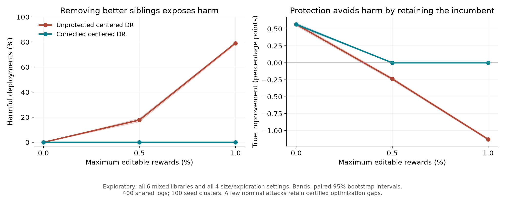

# Near-incumbent policies: vulnerability, refusal, and the candidate library

This follow-up tests whether the negative result in [E2](../security/README.md) was caused by an overly easy candidate library. We construct policies close to the incumbent using validation data, freeze them before the new evaluation, and retain the previous attack and defense implementations. The results identify a more informative security benchmark, but they do not yet demonstrate a defense that remains useful under attack.

Two findings matter. First, bringing policies closer in value is insufficient when every worse candidate has a better sibling that cannot be displaced by the allowed attack. Second, removing those siblings exposes frequent harmful deployment, while the correction prevents harm by declining every deployment at the tested nonzero budgets. The distinction between preventing damage and enabling improvement is therefore central to this experiment.

## Design and provenance

The incumbent, training split, reward model, logging policy, estimators, confidence allowances, and corruption budgets are unchanged from E2. The official UCI split supplies 3,058 fitting examples, 765 validation examples, and a fixed evaluation pool of 1,797 examples. Reward is one for a correct sampled digit prediction. All reported values integrate over a policy's action probabilities; they are not argmax classification accuracies.

Three candidate families mix a strong full-image classifier with a weaker parent: a more strongly regularized full-image classifier, a classifier using only the top half of the image, or one using only the bottom half. For each family, a mixture coefficient targets either a one-percentage-point loss or a one-point gain relative to the incumbent on validation data. The construction uses no evaluation labels. No clipping or post-evaluation candidate removal was necessary.

| Candidate family | Validation target (pp) | Evaluation improvement (pp) |
|---|---:|---:|
| Regularization mixture | −1.000 | −0.957 |
| Regularization mixture | +1.000 | +1.048 |
| Top-half mixture | −1.000 | −1.557 |
| Top-half mixture | +1.000 | +0.665 |
| Bottom-half mixture | −1.000 | −1.254 |
| Bottom-half mixture | +1.000 | +0.858 |

The incumbent's evaluation value remains 89.413%. Model fitting and mixture construction are implemented in [prepare.py](prepare.py). Its `freeze` command reads only the training file; a separate `evaluate` command verifies the saved hashes before opening the evaluation file. [selection.json](selection.json) records the weights, validation statistics, and construction hashes. E2 results on this dataset had already been inspected, so this is a development experiment, not an untouched external validation of a final method.

The primary experiment, **E3**, evaluates all six candidates. There are 100 fresh log seeds for each combination of log size 5,000 or 20,000 and exploration 0.2 or 0.5: **400 independent logs**. Each log is evaluated at reward-edit fractions 0%, 0.5%, and 1%, under clean, random-flip, and adaptive-attack conditions. Six estimators, each with and without the correction, plus always retaining the incumbent, give **46,800 decisions**. These decisions reuse logs and are not independent observations.

The secondary experiment, **E3b**, removes the within-family sibling pairing. It evaluates all six libraries containing one candidate from each family and both validation target signs. It reuses exactly the same logs and adds **280,800 decisions**, for **327,600 audited decisions in total**. The codes `m` and `p` denote the negative and positive validation targets in regularization/top/bottom order. This diagnostic was specified after inspecting the E3 timing run. It is exploratory, and all six libraries are reported. With three candidates, the confidence union factor is recomputed; point-estimate comparisons also change only the available candidates.

## Primary result: close values alone do not make a useful attack benchmark

For the primary centered-DR/Bernstein contrast, nominal and corrected rules have the same worst-case outcomes. With no allowed edits, mean improvement is 0.636 pp and fallback is 39.25%. At either nonzero edit budget, both rules retain the incumbent in every adaptive evaluation. The correction therefore adds no safety or utility benefit for this contrast.

The point-estimate rules also have no harmful deployments in E3. The exception among the thirteen rules is our nominal shrinkage/confidence adapter: five harmful deployments occur, all in one 100-log cell. Its corrected version always falls back. This is not evidence against Su et al.'s original estimator; the confidence and tuning adapter is our own.

The absence of harmful point-estimate selections has a structural explanation. For every family, log, and budget, the exact worst-case margin of the better sibling over the worse sibling remains positive for nominal IPS, fitted DR, centered DR/Bernstein, and fitted DR/Bernstein. Even the smallest IPS margin is 0.249 pp. Thus, a worse sibling cannot win while its better sibling remains available. These are deterministic checks against all allowed real-valued reward replacements, not conclusions drawn from a failed optimizer. The derivation is in [METHODS.md](METHODS.md), with all cases in the result archive and a compact [sibling-margin table](sibling_summary.csv).

## Diagnostic result: attacks work, but the defense mainly refuses

The table below averages equally over all six E3b libraries and four size/exploration settings, at each stated budget. Harm rates are attained by feasible adaptive attacks against the actual decision rule. A few nominal attacks have unresolved optimization gaps, reported below. Improvement includes zero on fallback.

| Reward edits allowed | Rule | Harmful deployment | Mean improvement (pp) | Fallback |
|---|---|---:|---:|---:|
| 0% | Centered DR / Bernstein | 0.00% | +0.566 | 39.96% |
| 0% | Corrected centered DR / Bernstein | 0.00% | +0.566 | 39.96% |
| 0.5% | Centered DR / Bernstein | 17.79% | −0.237 | 82.21% |
| 0.5% | Corrected centered DR / Bernstein | 0.00% | 0.000 | 100.00% |
| 1% | Centered DR / Bernstein | 79.08% | −1.128 | 20.92% |
| 1% | Corrected centered DR / Bernstein | 0.00% | 0.000 | 100.00% |



The fitted-DR/Bernstein comparison points in the same direction: unprotected harm is 6.63% at 0.5% corruption and 47.63% at 1%; its corrected version always retains the incumbent at both budgets. Corrected point estimates occasionally retain a small improvement, but they have no sampling guarantee and do not establish success for the confidence-based defense.

The protected centered-DR rule also declines deployment on every **clean** log when configured with either nonzero cap. Its utility loss is not solely an effect of the adaptive attacker. Averaging zero-edit and positive-budget strata together gives a positive mean improvement of 0.189 pp, but **all of that improvement comes from the zero-edit stratum**. We do not present that average as useful operation under corruption.

This is a successful vulnerability demonstration and a negative result for useful protected improvement at the tested budgets. The corrected rule improves on the attacked nominal rule because it avoids a loss, yet at nonzero budgets it offers the same outcome as always retaining the incumbent. That is not a compelling safety–utility frontier or a new publishable defense.

## What is certified, and what remains uncertain

The attacker changes only rewards, with at most the declared number of replacements in [0,1]. It knows the models, log, deployment rule, and true candidate ordering; the defender does not know the ordering. Contexts, actions, logging probabilities, fitted models, and the corruption cap are trusted. The search produces feasible binary-flip attacks; score envelopes and checked LP dual bounds cover real-valued replacements as well.

All 14,400 non-retain adaptive E3 evaluations have matching feasible-attack and certificate utility values. Across the 86,400 corresponding E3b evaluations, **ten** retain unresolved utility gaps: six for nominal centered DR/Bernstein, three for nominal fitted DR/Bernstein, and one for nominal DR point estimation. The largest gap is 1.557 pp. The supplied tables retain both the attained value and its certified lower bound. No unresolved case is labeled robust merely because search stopped.

All corrected E3b decisions exclude harmful selection under every allowed real-valued reward replacement on the stored logs. This does not imply zero risk on future logs. A fixed cell still contains only 100 independent log draws; the one-sided 95% binomial upper limit for zero observed harms is 2.95%. Libraries and budgets reuse those draws. Aggregate uncertainty uses 100 paired seed clusters, and does not remove optimization gaps or uncertainty beyond this fixed dataset.

The audit reconstructs all 327,600 decisions, regenerates the sampled logs, recomputes 12,091 LP dual certificates, checks score envelopes and possible-outcome sets, and compares merged records with every completed shard. The maximum score reconstruction discrepancy is 5.56e−17. Five inherited mathematical tests and three construction/information-separation tests pass.

## Relation to prior work and the next research step

The clean starting benchmark is [Kuzborskij et al. (2021)](https://proceedings.mlr.press/v130/kuzborskij21a.html). [Dudik et al. (2011)](https://arxiv.org/abs/1103.4601) provide DR evaluation, [Su et al. (2020)](https://proceedings.mlr.press/v119/su20a.html) provide optimistic importance-weight shrinkage, and [Lobo et al. (2022)](https://proceedings.mlr.press/v180/lobo22a.html) establish poisoning attacks on OPE as a research problem. Our additions are the incumbent-relative attack/correction experiment, validation-designed policy libraries, the exhaustive sibling-removal diagnostic, and reproducible decision-level auditing. We do not claim a new DR estimator, a reproduction of Lobo's influence-function attack, or a complete rerun of every literature baseline. The prior E2 ESLB supplement is preserved but was not rerun here.

For the course project, this supplies a concrete attack–defense comparison with a random-corruption control, an adaptive attacker, a refusal baseline, and an explicit failure of the desired usefulness criterion. For a paper, the missing result is more demanding: preserve useful improvement at a nonzero corruption budget, under a sufficiently strong attack and an honest uncertainty allowance. A finer budget curve can locate the transition, but would still be benchmark characterization. A substantive method would need tighter justified uncertainty control or a defined amount of trusted additional evidence, followed by independent datasets and policy families. The present experiment does not establish novelty or predict UAI acceptance.

## Reproduction

E3 took 95.4 seconds and the six-library E3b run took 114.6 seconds using four CPU processes on an Apple M5 Pro with 24 GiB RAM. These are experiment runtimes; model preparation, timing checks, auditing, and packaging are separate. The earlier E2 run was slower because it encountered many more unresolved attack targets.

Install the pinned [E2 dependencies](../security/requirements-security.txt). From the repository root, extract the existing E2 archive if needed, then the new archives:

```bash
python -m zipfile -e security/security_results.zip security
cd boundary
python -m zipfile -e boundary_primary.zip .
python -m zipfile -e boundary_logs.zip .
python -m zipfile -e boundary_timing.zip .
python -m zipfile -e subset_mmp.zip .
python -m zipfile -e subset_mpm.zip .
python -m zipfile -e subset_mpp.zip .
python -m zipfile -e subset_pmm.zip .
python -m zipfile -e subset_pmp.zip .
python -m zipfile -e subset_ppm.zip .
python restore_logs.py
python -m unittest test_boundary.py
python analyze.py --mode main
python analyze_subsets.py --mode main
python diagnostics.py
```

The archives omit duplicate log arrays; `restore_logs.py` restores their exact content from the shared primary logs without resampling. Every decision, attack witness, model parameter, selection weight, certificate, and shard needed for the audit is included. The eight timing logs are excluded from main inference. `subset_experiment_used.py` preserves the executed runner; the current runner additionally filters two descriptive metadata lists to the retained candidates. This metadata-only repair did not change predictions, attacks, or decisions.

To rerun from scratch, use a separate checkout without extracted result or model directories:

```bash
python prepare.py freeze
python prepare.py evaluate
python run_parallel.py --mode timing
python run_parallel.py --mode main
python subset_experiment.py prepare
python subset_experiment.py timing
python subset_experiment.py main
```

Readable outputs: [primary cell results](primary_summary.csv), [primary aggregate](primary_aggregate.csv), [primary paired effects](primary_paired_safety_utility.csv), [all diagnostic cells](subset_main_cells.csv), [diagnostic aggregate](subset_main_aggregate.csv), [budget-stratified results](budget_summary.csv), [primary audit](primary_audit.json), and [diagnostic audit](subset_main_audit.json). [METHODS.md](METHODS.md) provides the equations and information boundaries. `BOUNDARY_MANIFEST.sha256` checksums the release. Earlier E0 and E2 source and result files are preserved.

The data are [UCI OptDigits](https://doi.org/10.24432/C50P49), attributed to E. Alpaydin and C. Kaynak under CC BY 4.0. Attacks modify local benchmark copies only; no external service or deployed model is targeted.
