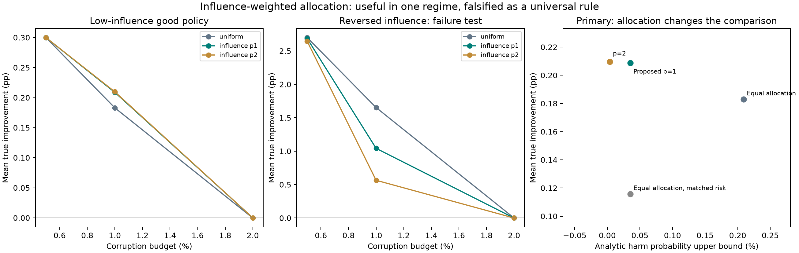

# Confidence allocation under reward poisoning: a controlled tradeoff

This extension produces a security–utility tradeoff at a fixed nonzero reward-corruption budget and tests a simple method for improving it. It also includes a counterexample to that method. The purpose is to identify a mechanism worth studying, with a stronger standard of evidence than a favorable attack plot alone.

**Primary result.** At 20,000 observations, 1% reward corruption, and a total confidence-error budget of 1%, influence-weighted allocation obtains **+0.2088 percentage points of mean improvement**, versus **+0.1830 pp** for equal allocation. Harmful deployment is **0/1,000** versus **3/1,000**. A model-specific bound on harm decreases from **0.2093% to 0.0353%**. Compared with equal allocation calibrated to the same harmful-candidate bound, improvement is **+0.2088 versus +0.1158 pp**. Always retaining the incumbent gives zero.

These results concern a **controlled synthetic stochastic contextual bandit**. The separate [OptDigits acquisition experiment](../design/README.md) establishes useful protected improvement on a real-feature benchmark, but uses a different method. The present confidence method has not yet been generalized to the variable importance coefficients of OptDigits.

## Benchmark: separate policy quality from sensitivity to edits

Contexts contain two independent signs, s and z, each equally likely to be −1 or +1. There are two actions. The incumbent and logger choose each action with probability one half. Rewards are stochastic:

$$R\mid s,z,a\sim\operatorname{Bernoulli}\left(\tfrac12+(2a-1)(\beta s-\theta z)\right).$$

A signal-following candidate chooses action 1 with probability 1/2+g s. A nuisance-following candidate chooses it with probability 1/2+b z. Their population improvements are

$$\Delta_g=2g\beta,\qquad\Delta_b=-2b\theta.$$

The primary parameters are g=.05, b=.45, beta=.03, theta=.001: the good policy improves reward by 0.3 pp and the bad policy loses 0.09 pp. Their paired importance coefficients have magnitudes B_g=.1 and B_b=.9. Thus, the bad policy's estimate is much more sensitive to a reward edit. This difference is independent of whether its true value is close to the incumbent.

Both policies have continuous probability parameters. The deployment candidate list is finite. The benchmark is deliberately small enough to compute ground truth and certify the worst attack. It is not presented as a realistic application or a learned-policy generalization benchmark.

The full grid uses log sizes 5,000, 20,000, and 100,000; signal strengths .02, .03, and .05; and corruption fractions .5%, 1%, and 2%. The allocation experiment includes amplitude pairs (.05,.15), (.05,.45), and the reversed pair (.45,.05). Every cell is reported.

## Methods and what is new in this project

For constant coefficient magnitude B_j and binary rewards, define Y_ji=1 when the signed centered reward contribution is positive. Then

$$\Delta_j=B_j\left(\mathbb E[Y_{ji}]-\tfrac12\right),\qquad T_j=\sum_iY_{ji}.$$

At most k reward edits can change T_j by at most k. Let CP_alpha(t;n) be the one-sided Clopper–Pearson lower limit, with CP_alpha(0;n)=0. The corruption-adjusted score is

$$L_j=B_j\left[\operatorname{CP}_{\alpha_j}\bigl(\max(0,T_j-k);n\bigr)-\tfrac12\right].$$

Choose the largest positive score; otherwise retain the incumbent. Real-valued edited rewards are thresholded at 1/2 before this binary gate, so any allowed replacement still changes at most one favorable indicator per edited row. The clean Bernoulli observations are unchanged by this preprocessing.

**Equal allocation** sets alpha_j=alpha/2. **Influence-weighted allocation**, the proposed project method, sets

$$\alpha_j=\alpha\,\frac{B_j^{-p}}{\sum_\ell B_\ell^{-p}},\qquad p=1\ \text{primarily},\quad p=2\ \text{secondarily}.$$

The coefficients come from frozen policies and known propensities, before rewards are observed. The weights therefore do not use the true policy ranking or attacked data. Since the allocated errors sum to alpha, the simultaneous confidence statement remains valid. In the primary setting, p=1 allocates .009 to the low-influence candidate and .001 to the high-influence candidate.

This is a new implementation and combination **for this project**. Exact binomial intervals and weighted multiple testing are established methods. We make no verified novelty claim for either ingredient or their combination. The scientific question is whether the allocation should depend on policy influence, expected improvement, or both under an adversarial deployment objective.

## Results with the actual adaptive attacker

The table uses the same 1,000 fresh E7 logs and the primary 1% corruption budget. Nominal controls were added afterward as a disclosed diagnostic on those logs; protected comparisons were fixed before the run.

| Rule | Mean improvement (pp) | Harmful deployment | Fallback |
|---|---:|---:|---:|
| Always retain | 0.0000 | 0.0% | 100.0% |
| Equal allocation, unprotected | +0.1619 | 35.4% | 0.0% |
| Influence allocation p=1, unprotected | +0.2263 | 18.9% | 0.0% |
| Equal allocation, protected | +0.1830 | 0.3% | 38.6% |
| **Influence allocation p=1, protected** | **+0.2088** | **0.0%** | **30.4%** |
| Influence allocation p=2, protected | +0.2097 | 0.0% | 30.1% |
| Equal allocation, matched harmful-candidate risk | +0.1158 | 0.0% | 61.4% |

The prespecified p=1 improvement over equal allocation is **+0.02577 pp**, with paired 95% bootstrap interval **[+0.02067, +0.03108]**. It retains 69.6% of the good policy's available improvement, versus 61.0% for equal allocation. Against the matched-risk comparator, the difference is **+0.0930 pp**, interval **[+0.0843, +0.1017]**.

The matched-risk comparator gives both candidates the p=1 method's harmful-candidate error allocation. It is an evaluation control defined using the known harmful candidate, not a generic deployable tuning rule. Its total confidence budget is .002, compared with .01 for the proposed method. This comparison asks whether unequal allocation improves usefulness at the same harmful-candidate risk, not whether the two use identical per-candidate budgets.

Zero observed harm is not zero population risk. The ordinary one-sided 95% binomial upper limit from 0/1,000 observations is 0.299%. Here, the specified stochastic model also lets us calculate a stronger analytical bound: the probability that the harmful candidate's clean lower bound is positive. That probability is **0.0353%** for p=1 and **0.2093%** for equal allocation. These bounds include new log realizations under the stated model; they are not distribution-free real-world safety claims.



## A counterexample that changes the research conclusion

When the good policy has the *larger* influence magnitude, the same rule allocates it less confidence error and becomes too conservative. In the reversed primary setting, p=1 yields **+1.0422 pp**, compared with **+1.6524 pp** for equal allocation. Harm is 0.4% versus 0.2%. The utility difference is **−0.61022 pp**, with paired interval **[−0.68311, −0.54001]**.

Thus the method improves both observed axes in the prespecified primary regime, and improves usefulness at matched harmful-candidate risk there, but **fails as a universal allocation rule**. This reversal was included before E7 outcomes. It is not an omitted corner case. It shows that influence alone is an insufficient allocation criterion.

There is a simple conditional explanation for the favorable regime: increasing the good candidate's error allocation raises its lower score, while decreasing the bad candidate's allocation lowers its score. On every fixed log and attack, these movements favor the good decision. The theorem of confidence coverage survives either allocation, but the benefit requires the allocation to favor the right policy. A general method must obtain that information without using evaluation labels or allowing the attacker to choose the allocation through poisoned data.

## Why we did not stop at the first apparent gain

E6 initially compared the corruption-adjusted exact interval with the Bernstein gate used in earlier stages. At the same nominal confidence level, the exact interval retained more utility. E6b confirmed the risk–utility curve on 1,000 new seeds.

A stricter E6c control then matched the harmful-candidate threshold exactly. **All 1,000 deployment decisions became identical.** The first apparent gain was better calibration of a confidence bound, not a new decision frontier. That control is preserved in [matched_risk_result.json](matched_risk_result.json).

E7 changes allocation across policies instead. Its primary benefit survives the matched harmful-candidate threshold control, while the reversed test identifies its failure. This distinguishes a meaningful conditional decision effect from a merely relabeled confidence parameter.

## Attacks, uncertainty, and verification

The attacker sees the log and the complete final gate, and can edit at most k rewards. To make the bad policy win, it flips rows favorable to the good candidate and unfavorable to the bad one. This simultaneously maximizes the bad score and minimizes the good score. To force retention, it flips rows favorable to both, simultaneously minimizing both scores.

Every evaluated log contains enough rows of both types. The audit checks this, feasibility of every edit vector, and monotonicity-based endpoint bounds. As a result, the recorded adaptive outcome is the **exact worst selected-policy utility**, rather than the result of a heuristic that might miss an attack. Four mathematical tests include exhaustive row-level enumeration on small cases and direct binomial-coverage enumeration. The simulator samples 16-type multinomial counts, which is exactly the sufficient-statistic distribution of iid row logs; it does not approximate those logs by expected counts.

E6 contains 810,000 decisions from 9,000 logs. E6b contains 60,000 decisions from 1,000 new logs. E7 contains 1,215,000 decisions from 9,000 new logs, plus 4,000 nominal-control decisions. Each stage uses 1,000 independent seed clusters; its methods, budgets, and policy amplitudes reuse logs. They are not millions of independent trials. All **2,089,000** decisions in these three stages and nominal controls were reconstructed. The additional 2,000 matched-risk diagnostic decisions are stored separately. There are no unresolved attack-utility gaps in this controlled benchmark.

Main simulation times on an Apple M5 Pro were 10.8 seconds for E6 and 18.1 seconds for E7. Their independent audits took 10.6 and 17.5 seconds. These times exclude analysis, plotting, and the earlier OptDigits experiment.

## Relation to prior work and the next contribution

[Clopper and Pearson (1934)](https://doi.org/10.1093/biomet/26.4.404) provide the exact binomial interval. [Roeder and Wasserman](https://arxiv.org/abs/1010.4637) study weighted hypothesis testing and the use of prior information to improve power. [Lobo et al. (2022)](https://proceedings.mlr.press/v180/lobo22a.html) provide the adversarial off-policy evaluation context; [Dudik et al. (2011)](https://arxiv.org/abs/1103.4601) provide the DR evaluation framework used in the earlier experiments. These works are ingredients and required novelty checks, not claims that we invented their methods.

For the course project, the contribution is now concrete: an adaptive poisoning benchmark, an exact attack certificate, a protected baseline, an influence-based allocation method, a successful regime, a matched-risk control, and a predeclared falsification regime. For a research paper, the missing step is a principled allocation method that handles both geometries and general importance coefficients. A promising question is how to allocate sampling effort and confidence error jointly using independent, imperfect evidence about policy improvement, while retaining guarantees against an attacker who knows the allocation rule. Any additional evidence must have its cost and trust assumptions included.

The current results do not establish a new weighted-testing principle, broad Pareto optimality, success on unseen datasets, or likely acceptance at UAI. They do establish a reproducible tradeoff and a sharper research problem.

## Files and reproduction

Install the pinned dependencies in [security/requirements-security.txt](../security/requirements-security.txt). From this directory:

```bash
python -m zipfile -e controlled_main.zip .
python -m zipfile -e controlled_risk.zip .
python -m zipfile -e controlled_allocation.zip .
python -m unittest test_experiment.py
python analyze.py main
python analyze.py risk
python allocation_analyze.py
python matched_risk.py
python nominal_controls.py
```

To generate the simulations again, use a separate copy without the corresponding result directories:

```bash
python experiment.py
python risk_curve.py
python allocation.py
```

Each runner refuses to overwrite a result directory. Frozen protocols, source hashes, log counts, attack edits, score witnesses, cell tables, analytical risk bounds, and audits are included. Each archive contains member hashes; `CONTROLLED_MANIFEST.sha256` checks the release. The preserved `exploratory_consistency.zip` contains the earlier latent-label ambiguity-set development, including unsuccessful attempts; it is not presented as a confirmed improvement.

Primary outputs: [allocation summary](allocation_summary.csv), [paired contrasts](allocation_contrasts.json), [analytical risk bounds](allocation_risk_bounds.csv), [allocation audit](allocation_audit.json), [exact-gate risk curve](risk_summary.csv), and [matched-risk falsification](matched_risk_result.json). All attacks target local simulated logs. No external service, user data, or deployed system is attacked.
