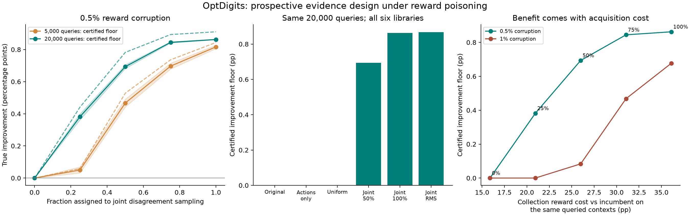

# Recovering useful policy improvement through targeted evidence collection

The previous experiment found a defense that avoided harmful deployment by retaining the incumbent on every log at the tested nonzero corruption budgets. This follow-up asks whether the same confidence-based deployment rule can become useful when the evidence is collected more carefully.

**It can, in this finite-pool experiment.** With 20,000 observations and a fixed allowance of 100 adversarial reward edits (0.5%), joint context-and-action targeting yields **0.910 percentage points of mean improvement under feasible adaptive attacks**. A deterministic lower bound covering *every* allowed real-valued reward replacement is **0.863 points**. All six candidate libraries retain positive improvement, and the primary comparison has no harmful deployments or fallback decisions. Always retaining the incumbent gives zero improvement.

The change is prospective data collection. It requires access to an unlabeled context pool from which informative examples can be queried. It does not repair the already collected E3 logs. Labels remain vulnerable to poisoning; no trusted reward sample or accurate reward-model assumption is added. The primary result is a useful acquisition–robustness tradeoff, not evidence that the correction itself is a new or superior defense.

## What changed, and why it helps

The candidates, incumbent, data split, and deployment rule remain fixed. Each policy is a trained stochastic classifier. On an OptDigits image, it assigns probabilities to ten digit predictions. The reward is one if the sampled prediction is correct and zero otherwise. A log is a collection of these image–prediction–reward observations with their known sampling probabilities.

Ordinary collection samples images uniformly and chooses actions mainly from the incumbent. A candidate can differ from the incumbent on a rarely observed image–action pair. Importance weighting compensates for that rarity, but it also gives an edited reward considerable influence. Previously, the largest coefficient was 15.756.

The new collector queries image–action pairs in proportion to the largest probability disagreement between the incumbent and any of the six frozen candidates. It uses predicted probabilities, never evaluation labels. Importance weighting then accounts for both the changed image distribution and the changed action distribution. The largest coefficient falls to 0.284 under the primary design, roughly a **55.5-fold reduction**. Each reward edit has less influence, and the confidence allowance becomes smaller.

A mixture parameter controls how much collection moves away from the original design. We evaluate the complete grid of 0%, 25%, 50%, 75%, and 100% targeting. The 100% design includes a 1% support mixture with ordinary collection. Additional controls target only actions, sample all image–action pairs uniformly, or use root-mean-square policy disagreement. [METHODS.md](METHODS.md) gives the estimator, confidence bound, corruption correction, and minimax influence calculation.

## Confirmation results

The following table fixes **20,000 observations and 0.5% corruption**, and averages equally over all six E3b libraries. Each library has 200 fresh log seeds. “Attained” means the utility achieved by a feasible attack against the full gate. The certified floor lower-bounds utility under all allowed edits, including edits missed by the search. True worst-case utility lies between the two.

| Collection and deployment rule | Attained improvement (pp) | Certified floor (pp) | Harmful deployments | Fallback |
|---|---:|---:|---:|---:|
| Always retain | 0.000 | 0.000 | 0.00% | 100.00% |
| Original collection, unprotected | −0.766 | −0.766 | 56.67% | 43.33% |
| Original collection, corrected | 0.000 | 0.000 | 0.00% | 100.00% |
| Action-only targeting, corrected | 0.000 | 0.000 | 0.00% | 100.00% |
| Uniform collection, corrected | 0.000 | 0.000 | 0.00% | 100.00% |
| Joint targeting 25%, corrected | +0.441 | +0.382 | 0.00% | 55.42% |
| Joint targeting 50%, corrected | +0.782 | +0.693 | 0.00% | 15.50% |
| Joint targeting 75%, corrected | +0.893 | +0.845 | 0.00% | 1.25% |
| Joint targeting 100%, corrected | **+0.910** | **+0.863** | **0.00%** | **0.00%** |
| Joint RMS targeting, corrected | +0.912 | +0.868 | 0.00% | 0.00% |

For the primary 100% design, the seed-cluster bootstrap 95% interval is **[0.908, 0.912] pp** for attained improvement and **[0.861, 0.864] pp** for the certified floor. Its 1,200 library–seed outcomes share 200 independent seeds; they are not 1,200 independent repetitions. A zero-harm cell with 200 draws has a one-sided 95% binomial upper limit of 1.49%, not zero future risk. The stronger log-specific result is that deterministic certificates exclude every harmful outcome on every primary log.

At the prespecified **1% stress budget**, the same corrected 100% design retains **+0.753 pp** attained improvement, with a **+0.677 pp** certified floor, no harmful outcomes, and 17.33% fallback. All 5,000-observation results, clean controls, random flips, library-level outcomes, and remaining optimization gaps are included in [cells.csv](cells.csv) and [summary.csv](summary.csv).



In the left panel, solid curves show certified floors and dashed curves show attained attack utility; shading is the paired 95% bootstrap interval for the floor. The middle panel compares collection designs at equal query count. The right panel shows the cost of gathering evidence versus the protected improvement it enables. These are finite experimental comparisons, not a proof of Pareto optimality.

## The price of the improvement

The most informative observations are often difficult images and actions the incumbent rarely chooses. Sampling them has a cost. On the same queried contexts, the expected reward shortfall relative to taking the incumbent's action is 15.88 pp under original logging, 26.00 pp under 50% targeting, and 36.11 pp under 100% targeting. These costs refer to the acquisition phase; the improvement above refers to subsequent deployment on the original uniform context population. They must not be conflated.

If contexts arrive uniformly and direct pool access is unavailable, rejection sampling could implement the context distribution. The expected arrival counts per accepted query are 1.00, 3.70, and 6.40 for those three designs. Thus 20,000 primary queries would require about 128,063 arriving contexts in expectation. Unqueried contexts could retain the incumbent. This is an analytical accounting calculation, not a separately simulated online deployment experiment.

Under a simple additive reward model, 20,000 primary queries incur about 7,222 reward units of shortfall relative to the incumbent on the queried contexts. Amortizing that against the certified mean deployment improvement of 0.008625 per decision requires roughly **837,000 subsequent decisions**. This illustrative calculation omits other operational costs and is conditional on the benchmark results. It makes clear why a cost-sensitive acquisition strategy is a worthwhile next research question. In an annotation or offline audit setting, query cost would instead be measured in labels, money, or analyst effort.

## What this establishes—and what it does not

The requested empirical target is met: positive protected improvement at a fixed nonzero corruption budget, with harmful deployment excluded on the evaluated logs, and positive deployment utility relative to retaining the incumbent. The mechanism is supported by the action-only and uniform controls: targeting contexts as well as actions is necessary among the tested designs to obtain the reported benefit.

Two observations limit the algorithmic claim. First, unprotected centered DR on the primary joint design also has zero harmful outcomes, excludes harm under the stored-log certificates, and attains the same 0.910 pp mean improvement. At some weaker targeting levels it is more useful than the corrected gate. **This experiment does not establish that the correction improves the empirical safety–utility frontier once collection is redesigned.** Second, the RMS design is at least as strong on the reported primary utility axes, with lower collection reward cost but a larger rejection-sampling envelope (8.49 arrivals per query). The maximum-disagreement design is not an empirical winner over all reasonable alternatives.

The result therefore supports **robust evidence acquisition for policy improvement** as a research direction. It does not yet supply a novel defense, an end-to-end net-reward gain at every deployment horizon, a theorem of optimal policy selection, or evidence sufficient to predict paper acceptance. The benchmark has a known finite context pool, repeated queries, fixed candidates, trusted contexts/actions/propensities, and no hidden confounding. Fresh log seeds validate behavior conditional on this pool; they do not replace new datasets or independently constructed policy families.

## Prior work and the contribution of this experiment

[Dudik et al. (2011)](https://arxiv.org/abs/1103.4601) supply the doubly robust evaluation framework. [Kuzborskij et al. (2021)](https://proceedings.mlr.press/v130/kuzborskij21a.html) provide the clean off-policy selection benchmark underlying this repository. [Lobo et al. (2022)](https://proceedings.mlr.press/v180/lobo22a.html) study adversarial corruption of off-policy evaluation. Our security gate and its bounded-edit correction are documented in the earlier stages; we do not reproduce Lobo's influence-function attack here.

Data acquisition for policy evaluation is also established. [Tucker and Joachims (2022)](https://arxiv.org/abs/2202.01721) propose Minimum Variance Augmentation Logging to improve evaluation and learning through additional data. [Mukherjee et al. (2024)](https://proceedings.mlr.press/v238/mukherjee24a.html) study experimental design for policy evaluation in linear heteroscedastic bandits. Neither MVAL nor SPEED is reimplemented in this release. The RMS comparator is our explicit second-moment design for the present paired estimator, not a claimed reproduction of either algorithm.

Our addition is a matched, audited experiment combining prospective joint evidence design with incumbent-relative confidence gates and adaptive reward poisoning. The simple minimax influence normalization is not presented as a new importance-sampling principle. A paper would need a sharper contribution: for example, choose evidence to minimize cost subject to a robust improvement certificate, compare against strong acquisition baselines, and study when joint identification information reduces the cost of selecting among policies.

## Development, confirmation, and verification

Development first evaluated influence clipping and action-only logging changes, retaining all 5,880 outcomes. It then evaluated joint context/action targeting on 1,200 additional development outcomes. These records are preserved, including unsuccessful configurations. The subsequent [confirmation protocol](confirmation_protocol.json) fixed the full grid, primary endpoint, 200 fresh seeds, and success rule before the main run.

The confirmation covers eight collection designs, two query counts, two nonzero corruption budgets, six candidate libraries, three deployment rules, and three attack conditions: **345,600 decisions from 3,200 distinct logs**, organized in **200 independent common-random-number seed clusters**. Main computation took 179.2 seconds using four CPU processes on an Apple M5 Pro. The independent audit took 54.4 seconds. Eleven mathematical tests pass; the audit reconstructs all decisions, all 230,400 non-retain witnesses, and 9,057 LP dual certificates. Maximum score discrepancy is 4.34e−16.

If deterministic envelopes already exclude every harmful outcome, the main attacker uses target/rival endpoint attacks and nominal LP refinements without spending MILP restarts on distinguishing nonnegative outcomes. Otherwise it runs the inherited adaptive MILP attack. This compute rule was frozen before main confirmation. All residual gaps are reported: **300 of the 1,200 primary outcomes** have unresolved exact utility, but none has unresolved harm. The positive certified floor is the prespecified success endpoint and covers these cases. Across the entire adaptive grid there are 4,011 nonzero utility gaps. A timing-only source-hash recording issue is documented in [TIMING_PROVENANCE.txt](TIMING_PROVENANCE.txt); original sources and timing records are retained, and no timing outcomes enter inference.

## Reproduction

Install the existing [security dependencies](../security/requirements-security.txt). From the repository root:

```bash
# Supplies exactly the existing frozen E3 probabilities and library specification.
python -m zipfile -e design/inputs.zip .
cd design
python -m zipfile -e results_joint_0.zip .
python -m zipfile -e results_joint_0.25.zip .
python -m zipfile -e results_joint_0.5.zip .
python -m zipfile -e results_joint_0.75.zip .
python -m zipfile -e results_joint_1.zip .
python -m zipfile -e results_action_only.zip .
python -m zipfile -e results_uniform.zip .
python -m zipfile -e results_joint_rms.zip .
python -m zipfile -e development_and_timing.zip .
python -m unittest test_design.py
python -m unittest discover -s ../security -p test_experiment.py
python analyze.py --audit
python analyze.py
```

The archives contain individual decision tables, attack edits, checked certificate inputs, and shard metadata. Log arrays are reconstructed deterministically from the pinned NumPy version, frozen models, design, and saved seeds; every reconstructed log is checked against its recorded hash. `DESIGN_MANIFEST.sha256` covers release files, and each archive includes a member checksum table. To generate new data, run `python confirmation.py main` in a separate copy without an existing `results_main` directory; it refuses to overwrite a previous run. `develop.py` and `joint_develop.py` reproduce the development stages. The original timing implementation is preserved for provenance, not recommended as the default runner.

Earlier E0/E2/E3 experiments are preserved. The data are [UCI OptDigits](https://doi.org/10.24432/C50P49), attributed to E. Alpaydin and C. Kaynak under CC BY 4.0. All poisoning is simulated locally on public benchmark data; no external system is attacked.
