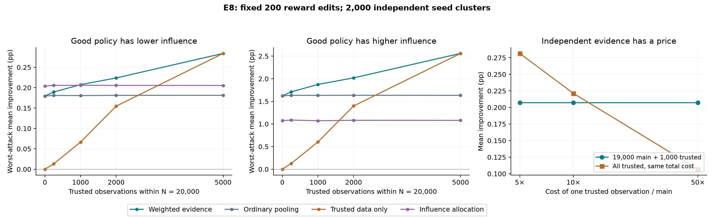

# When is trusted evidence worth its cost under reward poisoning?

The previous confidence-allocation experiment favored policies with small importance coefficients. It helped when the better policy had low influence, but failed when the relationship was reversed. This experiment replaces that assumption with an explicit allocation of weight between two sources of evidence: a large corruptible log and a smaller, independently collected reference sample.

The resulting rule improves worst-attack utility over ordinary pooling in **both policy geometries**. Its benefit survives a control that matches the harmful-candidate risk bound. However, independent evidence is neither free nor automatically trustworthy. A cost-matched alternative using only trusted observations wins when trusted data is sufficiently inexpensive. If the reference sample can also be poisoned, the advantage can disappear.

These findings concern the controlled synthetic benchmark introduced in [E6–E7](../controlled/README.md). They do not establish a result on OptDigits, a new general statistical principle, or global Pareto optimality.

## The experiment and its trust boundary

There are four equally likely contexts `(s,z)`, with each coordinate in `{−1,+1}`, and two actions. The incumbent and logging policy randomize uniformly. Rewards follow

$$R\mid s,z,a\sim\operatorname{Bernoulli}\left(\tfrac12+(2a-1)(\beta s-\theta z)\right).$$

The two fixed candidates have action probabilities `1/2 + g s` and `1/2 + b z`. Their true improvements are `2g beta` and `−2b theta`. Their paired importance-coefficient magnitudes are `B_1=2g` and `B_2=2b`. Policies have continuous probability parameters; the candidate set is finite.

The primary setting has **20,000 total observations**, of which **1,000 are trusted** and **19,000 are corruptible**. The attacker can edit **200 rewards**, fixed at 1% of the total budget across every method. We do not quietly reduce the attack budget to 1% of the smaller main sample. The primary signal parameters are beta=.03 and theta=.001. We test both `(g,b)=(.05,.45)` and `(.45,.05)`.

The trusted observations come from the **same population and logger**, independently of the main sample. Their outcomes cannot be edited in the main experiment. The attacker sees both samples, the policies, and the complete decision rule. Policies, contexts, actions, and propensities are trusted. All poisoning is performed locally on simulated rewards. No service or real user data is attacked.

The full, frozen grid contains reference sizes 0, 250, 1,000, 2,000, and 5,000; signal strengths .02, .03, and .05; corruption fractions .5%, 1%, and 2%; and both influence geometries. All methods use the same samples within each cell. There are **2,000 fresh seed clusters**, shared across comparisons, not millions of independent replications.

## Method: choose evidence weights without knowing policy quality

For these constant-magnitude coefficients, each centered paired contribution can be written as `B_j(Y_ji−1/2)`, with binary `Y_ji`. Let `U_j` and `V_j` be the favorable counts in the main and reference samples. For a reference weight lambda,

$$S_j(\lambda)=(1-\lambda)\frac{U_j}{n_u}+\lambda\frac{V_j}{m},\qquad
\mathbb E[S_j]=\tfrac12+\frac{\Delta_j}{B_j}.$$

Write this as `(a U_j+c V_j)/D` using integer coefficients. For example, the primary design chooses lambda=.20 and therefore

$$S_j=\frac{4U_j+19V_j}{95,000}.$$

The reference sample is 5% of the observations but carries 20% of the statistical weight. This increases sampling variability and decreases the influence of corruptible observations.

For each weight, compute the exact null threshold

$$h_\lambda=\min\{h:\Pr[aX+cZ\ge h]\le\alpha/2\},\qquad
X\sim\operatorname{Bin}(n_u,1/2),\quad Z\sim\operatorname{Bin}(m,1/2),$$

with independent `X,Z` and total alpha=.01. The maximum change in the weighted count is `d_lambda=a k` when the reference sample is protected. Choose lambda before inspecting rewards by minimizing

$$\lambda^*\in\arg\min_{\lambda\in\{0,.05,\ldots,1\}\cup\{m/N\}}
\left[\frac{h_\lambda-1/2+2d_\lambda}{D}-\frac12\right].$$

This objective is the standardized signal required for the mean to reach approval under the most damaging attack. One copy of the edit allowance accounts for actual damage, and one for the defender's correction. It is a design criterion, **not an oracle expected-utility optimizer**. The inputs are sample sizes, the declared edit cap, and alpha. It does not receive beta, theta, population policy values, or the identity of the good candidate.

The gate computes

$$G_j=B_j\frac{a\widetilde U_j+cV_j-d_\lambda-h_\lambda+1/2}{D}.$$

It deploys the candidate with largest positive `G_j`; otherwise it retains the incumbent. **These are approval margins, not confidence lower limits for the numerical size of improvement.** A positive margin certifies a one-sided test of positive improvement.

The primary design has `a=4`, `c=19`, `D=95,000`, `h=48,551`, and correction `d=800`. Ordinary pooling instead gives every observation equal weight. A reference-only rule ignores the main sample. Both are included in the design grid, although minimizing the stated threshold criterion does not guarantee maximum expected utility at every alternative.

### Why the gate remains valid under an adaptive attack

For each candidate, the corrected attacked weighted count is at most the unedited count. Under a nonpositive-improvement null, the favorable probability is at most 1/2, so the null distribution above stochastically dominates the clean count. Each harmful candidate therefore passes with probability at most alpha/2. A union bound controls harmful deployment by alpha for arbitrary dependence between candidate tests. Choosing the source weight from metadata before observing rewards does not spend additional testing error.

For real-valued reward replacements, the gate thresholds the observed reward at 1/2. Clean rewards are Bernoulli, and any edited row can change at most one favorable indicator per candidate. Thus the binary endpoint attack covers arbitrary allowed reward replacements in this benchmark. This argument does not automatically extend to general continuous rewards or variable importance coefficients.

## Comparators

All rules use the same total sample, edit budget and nominal alpha unless explicitly identified as a cost or risk diagnostic.

- **Ordinary pooling:** equal weight for every observation, with the full poisoning correction.
- **Influence allocation:** pooled observations, allocating alpha inversely to the fixed coefficient magnitude, as in E7.
- **Main only / reference only:** each source used independently, with its applicable correction.
- **Pilot selection:** use the independent reference sample to select the candidate with the largest standardized estimated improvement, then test that candidate on the main sample at alpha. The reference sample is not reused for confirmation.
- **Pilot-weighted confidence:** give 90% of alpha to the candidate with larger reference favorable count, 10% to the other, and split equally on ties; confirm using only the main sample.
- **Weighted evidence:** the proposed source-weight rule with equal error allocation across candidates.
- **Unprotected weighted evidence:** same source weight and threshold, omitting the poisoning correction.
- **Always retain:** zero improvement and no harmful deployment. It needs no observations operationally.

The independent-pilot comparators are valid conditional tests because their allocation depends on unalterable observations independent of the main sample. We explicitly exclude them from the reference-poisoning stress experiment: holding their allocations fixed there would be an incomplete adaptive attack.

## Primary results

Values are mean true improvement in percentage points under the **exact worst-utility attack** on each log. Harm and fallback are percentages of the 2,000 seeds.

| Rule | Low-influence good: gain | Harm | Fallback | High-influence good: gain | Harm | Fallback |
|---|---:|---:|---:|---:|---:|---:|
| Always retain | 0 | 0% | 100% | 0 | 0% | 100% |
| Main only | +0.1353 | 0.35% | 54.45% | +1.2258 | 0.15% | 54.45% |
| Reference only | +0.0666 | 0.35% | 77.35% | +0.6048 | 0.25% | 77.35% |
| Pilot selection | +0.1579 | 0.05% | 47.30% | +1.4215 | 0.05% | 47.30% |
| Pilot-weighted confidence | +0.1588 | 0.10% | 46.95% | +1.4324 | 0% | 46.95% |
| Ordinary pooling | +0.1806 | 0.30% | 39.40% | +1.6335 | 0.10% | 39.40% |
| Influence allocation | +0.2059 | 0.05% | 31.30% | +1.0719 | 0.20% | 60.10% |
| **Weighted evidence** | **+0.2074** | **0.25%** | **30.55%** | **+1.8738** | **0.05%** | **30.55%** |
| Weighted evidence, unprotected | +0.2453 | 13.50% | 0.70% | +2.6797 | 0.05% | 0.70% |

The weighted-evidence improvement over ordinary pooling is **+0.026745 pp**, paired 95% bootstrap interval **[+0.021045,+0.032400]**, in the low-influence-good setting; and **+0.240305 pp [+.189010,+.291605]** when the good policy has high influence. Intervals use 10,000 paired seed resamples and are pointwise.

The method does **not** clearly beat influence allocation in the geometry favorable to that baseline: the difference is +.001470 pp, interval [−.003991,+.006870]. Its advantage is avoiding that baseline's large reversal failure while retaining useful improvement. Zero observed harm for some comparators should not be interpreted as zero risk.



## Risk matching and an analytical utility check

At nominal alpha=.01, the model-specific harmful-candidate positivity bound is **.24794%** for weighted evidence and **.20927%** for pooling. Thus a comparison of nominal alpha alone would conceal a small difference in actual risk calibration.

The prespecified diagnostic recalibrates every fixed-weight comparator to a common **.1% harmful-candidate upper-bound ceiling**, using the known evaluator probability `.499`. This is an **oracle evaluation control**, not information supplied to the proposed deployed method. Discreteness gives actual bounds .09944% and .09537%, respectively; they are not exactly equal.

| Rule, common risk ceiling | Low-influence-good gain | High-influence-good gain |
|---|---:|---:|
| Ordinary pooling | +0.15357 pp | +1.38915 pp |
| Weighted evidence | **+0.17807 pp** | **+1.60785 pp** |
| Paired difference | +0.024495 pp | +0.218700 pp |
| Paired 95% interval | [.018510,.030540] | [.164700,.271350] |

The advantage therefore survives substantially tighter risk matching. Empirical harm rates can exceed the population bound in a finite sample: for example, four harms in 2,000 runs is compatible with a small underlying probability. We report both observed counts and analytical bounds.

The specified population also permits a utility lower bound. Let `p_G` be the probability that the good candidate passes even after the most damaging edits and `p_H` bound the probability that the harmful candidate can pass. A union bound gives

$$\mathbb E[\Delta_{\rm selected}]\ge
\Delta_g\max(0,p_G-p_H)+\Delta_b p_H.$$

For the nominal weighted-evidence rule, this is **+.20545 pp** and **+1.85104 pp** in the two primary geometries. These are model-specific evaluation bounds, computed from the known simulation distribution; the defender does not know them. They substantiate positive utility beyond a failed attack search.

## The cost comparison changes the recommendation

A main observation costs one unit and a trusted observation costs rho units. The proposed primary design costs `19,000 + 1,000 rho`. The same budget can instead buy `floor((19,000+1,000 rho)/rho)` trusted observations. This alternative uses the same confidence level and does not need poisoning correction.

| Trusted/main price ratio | Cost-matched trusted sample | Trusted-only gain, low-influence good | Weighted-evidence gain |
|---|---:|---:|---:|
| 5× | 4,800 | **+0.28151 pp** | +0.20738 pp |
| 10× | 2,900 | **+0.22128 pp** | +0.20738 pp |
| 50× | 1,380 | +0.10683 pp | **+0.20738 pp** |

At 50×, the weighted-evidence advantage is +.100545 pp, interval [.093630,.107580]; it also wins in the reversed geometry by +.905860 pp. At nominal alpha, the all-trusted alternative wins at 5× and 10× in both geometries. These prices are scenarios, not measured costs. The apparent crossover between sampled prices is not an estimated universal threshold.

A disclosed **post hoc cost-and-risk diagnostic** applies the same .1% harmful-candidate ceiling to these monetary-cost alternatives, using the existing E8 seeds. In the low-influence-good setting, weighted evidence gives +.178065 pp; all-trusted alternatives give +.263805, +.180165, and +.064365 pp at 5×, 10×, and 50×. The 10× difference is inconclusive (paired interval [−.009765,+.005640] pp). The 5× loss and 50× advantage remain clear, and the reversed geometry gives the same conclusion. This refinement is not presented as fresh confirmation.

An all-trusted sample of 20,000 is included as an expensive reference. In the raw cost file, its `rho=0, acquisition_cost=0` fields are **sentinels for an unspecified price**, not free acquisition: its actual cost is `20,000 rho`. The cost-matched rows have explicit nonzero prices. Reference acquisition may also change actions, delay decisions, or require access permissions; these costs are outside this synthetic experiment.

## What happens if trusted evidence is not actually trusted?

We allow up to 1% of the reference rows to be edited, within the **same total budget of 200 edits**. For the primary reference size this permits ten reference edits and 190 main edits.

If the rule still assumes a perfectly trusted reference, low-influence-good utility falls from +.20738 to **+.16481 pp**, and observed harm rises from .25% to **.55%**. A rule redesigned with the reference-edit cap chooses ordinary pooling and obtains **+.18063 pp**, with .30% observed harm. The source-weight advantage disappears under this declared stress. A reference-only rule that ignores the breach suffers **1.90% observed harm**.

With a declared cap `q`, the maximum weighted corruption is

$$d_\lambda=a k+\max(c-a,0)\min(q,k).$$

The corrected gate and design objective use this quantity. This is a concrete falsification of treating independent observations as automatically secure. Independence and integrity are separate assumptions. Distribution shift between the reference and target populations has not been tested and would invalidate the same-mean argument without an additional bound.

## Attack completeness and reproducibility

For the harmful-deployment attack, flip rows favorable to the good candidate and unfavorable to the harmful one. For the retention attack, flip rows favorable to both. These attacks simultaneously attain the relevant coordinate extrema. Together with the zero-edit option, they identify the **globally worst selected-policy utility** for this two-candidate monotone gate. Under a reference cap, allocate edits first to the source with greater per-row weight. Every required row group has sufficient capacity; the audit reconstructs actual 16-type edit vectors.

The main experiment contains **4,860,000 decisions**, plus **192,000 cost-control decisions**, **96,000 trust-stress decisions**, and **16,000 matched-risk decisions**. All 5,164,000 decisions were verified. The additional post hoc cost-and-risk diagnostic contains 12,000 independently checked decisions. The independent audit regenerates the sample streams, reconstructs scores and feasible attack vectors, and checks the exact test thresholds with FFT convolution. The runner uses conditional binomial-tail summation instead. Five unit tests include exhaustive small attack enumeration, null calibration, and policy-index permutation checks. There are no unresolved attack-utility gaps in this benchmark.

The main simulation took 25.4 seconds and the independent main audit 38.1 seconds on an Apple M5 Pro. These times exclude implementation, analysis, packaging and earlier OptDigits runs. The compact 16-type sufficient statistics make this experiment inexpensive; they do not imply comparable runtime for general policies.

To reproduce from the repository root, install the existing [pinned dependencies](../security/requirements-security.txt), then:

```bash
cd evidence
python restore_results.py
python -m unittest test_method.py
python audit.py
python analyze.py
python cost_risk_diagnostic.py
python validate_results.py
```

`restore_results.py` extracts the supplied result archives and rejoins the six byte chunks of the original compressed outcome file, checking hashes. To simulate again, use a separate copy without `results/` and run `python run.py`. The runner refuses to overwrite existing results. Sources and protocol were hashed before outcomes. The full grid, unsuccessful cells, raw outcomes, reference costs, attack certificates and validation reports are retained. The figure was visually checked.

## Relation to existing work and the next research contribution

[Clopper and Pearson (1934)](https://doi.org/10.1093/biomet/26.4.404) supply the exact one-sample binomial testing foundation. [Roeder and Wasserman](https://arxiv.org/abs/1010.4637) discuss weighted testing and information used to allocate testing error. [Charikar, Steinhardt and Valiant](https://arxiv.org/abs/1611.02315) study learning with a small trusted sample alongside untrusted data; the general use of trusted evidence is therefore established. [Lobo et al.](https://proceedings.mlr.press/v180/lobo22a.html) study poisoning of off-policy evaluation. None of these papers is claimed to implement this exact two-source deployment gate, and we have not reimplemented their full algorithms here.

The contribution at this stage is a reproducible mechanism study: an explicit source-weight rule, an adaptive-attack certificate, a risk-calibrated comparison, a reversal test, and a cost/trust boundary. The next defensible paper target is to extend these ideas to **variable paired importance coefficients and learned policies**, deriving a valid guarantee and comparing against established robust OPE and evidence-acquisition methods on fresh datasets. The present exact binomial construction does not provide that generalization. Novelty of the proposed combination remains unverified.
