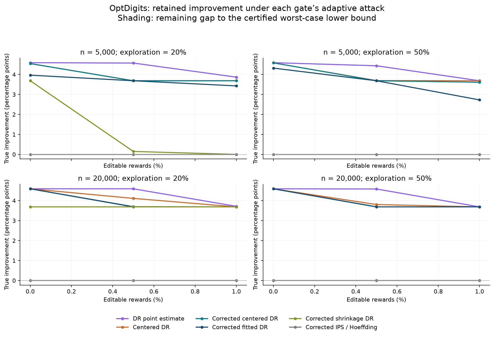

# Reward poisoning with independently trained OptDigits policies

We evaluate whether a policy-improvement rule can remain useful when an adversary changes a bounded number of logged rewards. Policies and the reward model are trained before evaluation and remain fixed during the attack. The experiment extends the clean reproduction in the [repository overview](../README.md); it is a modified benchmark, not a second reproduction of the original paper's table.

**The full pre-specified grid is complete. Its main result is negative for the proposed security advantage:** no harmful deployment occurred under any method, including unprotected point estimates. Moreover, the attack certificates exclude every harmful candidate for all tested logs within the declared reward-edit budgets. The correction therefore has no demonstrated harm-reduction benefit in this setting. It can reduce retained improvement.

## Design

The official UCI split contains 3,823 training and 1,797 test examples. We use 3,058 training examples for fitting and 765 for validation. The incumbent is multinomial logistic regression with C=0.1. Three candidates use C=0.01, 1, and 10; three others mix the incumbent with a uniform policy. Each fitted classifier has 650 continuous parameters. The finite object is the library of candidate models, not their parameterization.

Reward is one for a correct digit prediction. Evaluation draws contexts independently with replacement from the test pool and actions from a mixture of the incumbent and uniform exploration. The reward predictor is selected by validation log loss; C=1 wins. Test labels are available only to the environment, evaluator, and oracle ordering used by the attacker. Confidence calculations use the known finite context pool's features but not its labels.

The grid contains log sizes **5,000 and 20,000**, exploration probabilities **0.2 and 0.5**, and editable reward fractions **0%, 0.5%, and 1%**. There are **100 fresh log seeds per size/exploration setting**, hence **400 independent logs**. Each log is shared across thirteen rules and clean, random-flip, and adaptive-attack conditions. This yields **46,800 decision evaluations**, not 46,800 independent observations. The ten-seed timing runs are excluded from main inference.

The attacker may replace at most the specified number of rewards in [0,1]. Contexts, actions, logging probabilities, trained models, and the defender's rule remain trusted. Attacks target the actual final selection rule. The search constructs binary-flip witnesses; independent envelopes and checked LP dual bounds cover arbitrary real-valued replacements. Search failure is never treated as a safety certificate.

## Results

The following table averages improvement equally across all twelve size/exploration/budget cells under adaptive attack. Improvement includes zero when the rule retains the incumbent. Intervals bootstrap the 100 paired seed clusters. They describe sampling variation, not unresolved attack optimization error. The certified floor is a lower bound on worst-case utility; the attained attack outcome is an upper bound on that minimum.

| Rule | Mean improvement (pp), 95% CI | Certified utility floor (pp) | Harmful selections | Fallback |
|---|---:|---:|---:|---:|
| IPS point estimate | 4.292 [4.282, 4.302] | 4.292 | 0/1200 | 0.0% |
| Fitted DR point estimate | 4.294 [4.285, 4.303] | 4.294 | 0/1200 | 0.0% |
| Centered DR / Bernstein | 4.032 [4.022, 4.041] | 4.032 | 0/1200 | 0.0% |
| Corrected centered DR / Bernstein | 3.980 [3.970, 3.988] | 3.979 | 0/1200 | 0.2% |
| Fitted DR / Bernstein | 3.916 [3.906, 3.925] | 3.916 | 0/1200 | 0.0% |
| Corrected fitted DR / Bernstein | 3.814 [3.780, 3.846] | 3.814 | 0/1200 | 2.8% |
| Corrected shrinkage DR / Bernstein | 1.242 [1.232, 1.254] | 1.242 | 0/1200 | 66.3% |
| Corrected IPS / Hoeffding | 0.000 [0.000, 0.000] | 0.000 | 0/1200 | 100.0% |
| Always retain incumbent | 0.000 [0.000, 0.000] | 0.000 | 0/1200 | 100.0% |

All methods have zero observed harm. The entries in each row reuse logs across budgets; their denominator must not be interpreted as that many independent safety trials. Per cell, zero harms in 100 logs gives a one-sided 95% upper confidence limit of **2.95%** for new-log risk. A Bonferroni limit simultaneous across twelve cells is **5.33%**. Neither is a zero-risk statement.

The continuous-edit certificates exclude harmful selection in every one of the 14,400 non-retain adaptive evaluations. The minimum reachable utility is identified exactly in 14,070 of them. The remaining **330** retain an explicit gap between a feasible attack and a certified lower bound; their maximum gap is **0.906 pp**. These are unresolved utility rankings among non-harmful outcomes, not demonstrated safety failures.



The empirical harm–utility frontier is not evidence that the defense is Pareto-optimal. With harm tied at zero, the tested nominal point-estimate rules retain more average improvement than the conservative corrections. This reverses the positive interpretation of the earlier narrow synthetic pilot and is retained as a finding.

## Why this benchmark does not yet establish a security contribution

The incumbent's exact finite-pool expected reward is **89.41%**. The two better candidates improve it by **3.69** and **4.59 pp**. The closest worse candidate is already **7.94 pp** worse. The library therefore separates good and bad policies widely relative to these attack budgets. The certificate results show that failure to find harmful attacks is not merely an optimizer limitation on the tested logs.

A second limitation concerns confidence rather than point estimation. For C=10, n=20,000, and exploration 0.2, fitted DR has actual summand variance 0.0352, below centered DR's 0.0479. Yet its label-free second-moment allowance is 0.0962 versus 0.0500, producing a larger confidence radius (0.909 versus 0.651 pp). Our current bound does not exploit the fitted model's accuracy well. These are evaluator-only diagnostics; they do not tune the gate after seeing test labels.

Shrinkage supplies a related warning: validation MSE tuning can favor strong shrinkage, while a distribution-free bias allowance makes the resulting deployment gate conservative. This is a limitation of our confidence adapter, not a refutation of the original shrinkage estimator.

The next defensible study should pre-specify a policy library with alternatives near the incumbent's performance, using training/validation information rather than held-out outcomes to construct it. It should test a declared range of overlap and corruption budgets, preserve this run as a negative control, and investigate tighter confidence or bias control using explicitly trusted information. These changes are future work. The current result does not establish a publishable new algorithm or a general safety–utility improvement.

## Relation to existing work

| Source | Existing contribution used here | What this experiment adds or changes |
|---|---|---|
| [Dudik et al., 2011](https://arxiv.org/abs/1103.4601) | Doubly robust policy evaluation | A paired advantage, independently fitted reward model, corruption correction, and deployment evaluation |
| [Su et al., 2020](https://proceedings.mlr.press/v119/su20a.html) | Optimistic importance-weight shrinkage | The weight formula is reimplemented; our validation tuning and confidence/bias adapter differ from the paper |
| [Kuzborskij et al., 2021](https://proceedings.mlr.press/v130/kuzborskij21a.html) | Confident off-policy selection and the released OptDigits benchmark | E0 reproduces released code; E2 uses the official split, independently trained candidates, an incumbent, and reward attacks |
| [Lobo et al., 2022](https://proceedings.mlr.press/v180/lobo22a.html) | Data poisoning of OPE estimators | Our attack targets a frozen-model, reward-only deployment rule; it is not a reproduction of their influence-function attacks |

The complete equations, assumptions, estimator adapters, and threat model are in [METHODS.md](METHODS.md). The [execution record](PROTOCOL_HISTORY.md) documents the timing run and implementation refinements. The data are [OptDigits, UCI 80](https://doi.org/10.24432/C50P49), attributed to E. Alpaydin and C. Kaynak, under CC BY 4.0. All attacks modify local benchmark copies; no external system is targeted.

## ESLB comparison

The supplementary comparison runs the unchanged authors' ESLB estimator with our incumbent-relative adapter. It uses the first ten main seeds per setting, so it is not independent additional evidence. The primary Monte Carlo setting is 10 iterations × 100 samples; the first seed in each setting is also checked at 10 × 1,000. Both nominal and corrected adapters retain the incumbent throughout. All **792** supplemental decisions were reconstructed, and the **72** paired high/low Monte Carlo decisions agreed. This numerical check does not certify Monte Carlo integration error or justify a simultaneous 95% guarantee for the approximate implementation.

## Reproduction and artifacts

The main experiment took **22.58 minutes** of wall time using four CPU worker processes on an Apple M5 Pro with 24 GiB RAM. The ESLB supplement took **3.97 minutes** separately. These times exclude implementation, package installation, and result packaging. The main audit independently reconstructed **46,800 decisions** and recomputed **865 LP dual certificates**. Five mathematical tests cover exhaustive small cases and the estimator bounds.

From the repository root:

```bash
python3 -m venv .venv
source .venv/bin/activate
python -m pip install -r security/requirements-security.txt
python prepare_vendor.py
cd security
python -m zipfile -e security_results.zip .
python -m zipfile -e security_eslb_results.zip .
python -m unittest test_experiment.py
python analyze.py --results results_main
python audit_eslb.py
```

To regenerate models and run the full grid, use a separate checkout or move the supplied result folders aside first:

```bash
python experiment.py --mode prepare
python run_parallel.py --mode main
python eslb_supplement.py
python analyze.py --results results_main
python audit_eslb.py
python diagnostics.py
```

The archive contains frozen model parameters, training/validation indices, exact policy probabilities, sampled contexts and actions, every attack witness, per-decision outputs, dual certificates, the protocol, audits, timings, and supplementary ESLB gates. The public dataset archive is included with the attribution above. Files are checksummed in `SECURITY_MANIFEST.sha256`.

Readable entry points: [full cell table](summary.csv), [aggregate comparison](aggregate.csv), [paired comparisons](paired_comparisons.csv), [audit](audit.json), [model values](models.json), [moment diagnostics](moment_diagnostics.csv), [main outputs](security_results.zip), [ESLB outputs](security_eslb_results.zip), and [timing outputs](security_timing.zip). The earlier synthetic repository and E0 result archive are unchanged.
